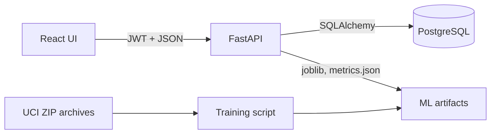

# Архітектура системи

Реалізовано простий трирівневий моноліт. Frontend (React, TypeScript, Vite, Tailwind, Recharts) звертається до REST API FastAPI. SQLAlchemy 2 зберігає записи у PostgreSQL, Alembic створює схему. Навчання працює окремою командою; API завантажує готовий `joblib` і метадані. Така межа не блокує обробку запитів довгим CV.

## Потоки даних

1. Логін повертає JWT з ID користувача й терміном дії 8 годин. API повторно читає роль та активність із БД для кожного захищеного запиту.
2. Записи пацієнтів, обстеження і показники потрапляють лише в БД. Seed створює синтетичні картки. Публічні UCI-рядки не імпортуються як пацієнти.
3. Скрипт читає ZIP із UCI або локального шляху, фіксує SHA-256, видаляє точні дублі ознак перед split, навчає pipeline та створює версійні артефакти.
4. Оцінка: сервер перевіряє повний контракт ознак, завантажує модель, обчислює `predict_proba`, зберігає незмінний JSON snapshot та аудит без значень ознак.

Структура даних концептуально відповідає FHIR Patient (картка) та Observation (структурований показник), але FHIR REST/ресурси та повна відповідність стандарту не реалізовані.
