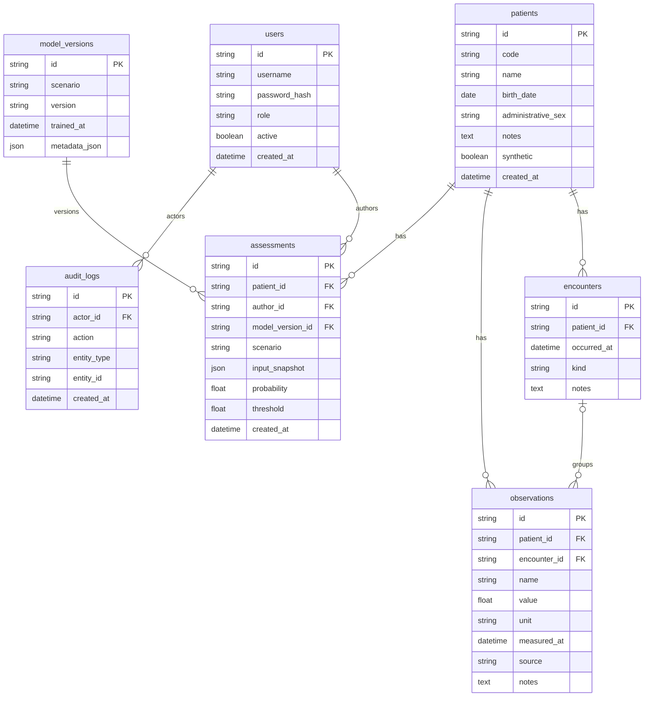

# Схема даних

Рядкові UUID забезпечують стабільні ідентифікатори. Час подій зберігається з часовим поясом (UTC на записі). `birth_date` — дата без часу. Зовнішні ключі та індекси задано в SQLAlchemy-моделях і застосовано Alembic-міграцією.

`input_snapshot` не змінюється через API; редагування та видалення оцінок не передбачено. Журнал фіксує тип операції, актора, сутність та час без медичних значень.
